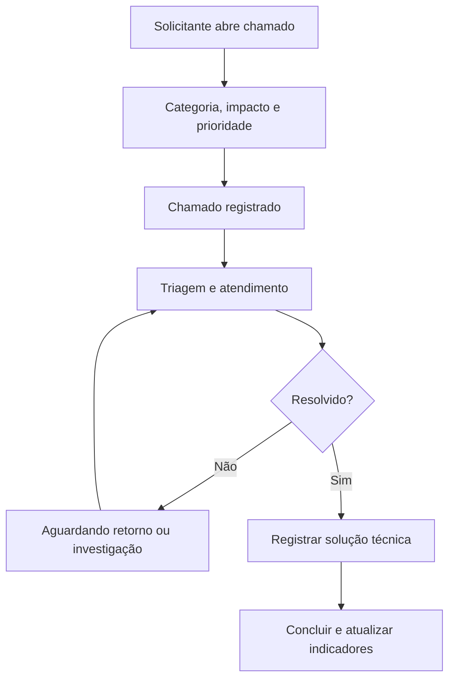

<div align="center">


<br />


**Uma plataforma demonstrativa para organizar chamados, apoiar diagnósticos técnicos e acompanhar ativos de TI.**

[Visão geral](#-sobre-o-projeto) · [Funcionalidades](#-funcionalidades) · [Tecnologias](#-tecnologias) · [Executar](#-como-executar-localmente) · [Autor](#-autor)

</div>

---

## 💡 Sobre o projeto

O **OTHX Help Desk** é um protótipo de central de atendimento de Tecnologia da Informação, criado para explorar como transformar problemas do suporte técnico em fluxos mais claros, rastreáveis e organizados.

A proposta surgiu de situações que encontro na minha trajetória profissional, conectando **suporte, análise de processos e desenvolvimento de software**. O desenvolvimento começou durante a **Imersão Engenharia de Software: Dev na Era da IA**, da **Alura**, com apoio do **Google AI Studio**.

> **O desafio:** como reunir abertura de chamados, acompanhamento, conhecimento técnico e inventário em uma experiência única e simples de utilizar?

> [!IMPORTANT]
> Este repositório é um **projeto de estudo e demonstração**, sob a marca fictícia **OTHX Solutions**. Não é um sistema oficial da empresa onde trabalho nem representa uma implantação corporativa. Os dados exibidos publicamente devem ser fictícios.

## ✨ Funcionalidades

| Módulo | O que oferece |
| --- | --- |
| 📊 **Dashboard** | Indicadores dinâmicos de chamados, distribuição por categoria, fluxo de status e MTTR dos chamados concluídos com datas válidas. |
| 🎫 **Gestão de chamados** | Listagem em tabela ou Kanban, ordenação, pesquisa, filtros e navegação para detalhes do atendimento. |
| 📝 **Abertura de OS** | Formulário com validação, categoria e subcategoria, avaliação de impacto, prioridade sugerida e número sequencial. |
| 🧑‍💻 **Atendimento técnico** | Acompanhamento do status, prioridade, técnico, comentários, notas internas, histórico e solução de encerramento. |
| 🧭 **Diagnósticos guiados** | Procedimentos demonstrativos para hardware, impressoras, rede, VPN e sistemas corporativos. |
| 📚 **Base de conhecimento** | Consulta e gerenciamento de artigos técnicos para problemas recorrentes. |
| 🖥️ **Inventário de TI** | Cadastro de equipamentos e associação com histórico de chamados. |
| ⚙️ **Configurações** | Perfis simulados, armazenamento local e importação/exportação de dados JSON. |

<details>
<summary><strong>🔎 Ver fluxo demonstrativo de um chamado</strong></summary>



*Fluxo conceitual da experiência do protótipo.*

</details>

## 🖼️ Telas do sistema

As capturas de tela serão adicionadas nesta seção. Sugestão de imagens (sem dados reais):

| Dashboard | Gestão de chamados |
| --- | --- |
| Indicadores, gráficos e chamados recentes | Visão em tabela e Kanban |

| Diagnósticos | Inventário |
| --- | --- |
| Testes orientados passo a passo | Cadastro e histórico de ativos |

**Para inserir as imagens:** crie a pasta `docs/screenshots/` e adicione `dashboard.png`, `chamados.png`, `diagnosticos.png` e `inventario.png`. Depois, substitua a tabela acima por imagens Markdown, como ``.

## 🧰 Tecnologias

<div align="center">


</div>

- **React 19:** componentes de interface.
- **TypeScript:** tipagem estática e manutenção do código.
- **Vite:** ambiente de desenvolvimento e build.
- **Tailwind CSS:** estilos e layout.
- **React Router:** navegação entre páginas.
- **Lucide React e Motion:** ícones e efeitos de interface.
- **localStorage:** persistência local demonstrativa, conforme a versão do projeto.
- **Google AI Studio:** apoio no processo de prototipação e desenvolvimento.

> O `package.json` também declara outras dependências. A presença de um pacote não significa necessariamente que todas as suas funcionalidades estejam em uso na interface.

## 🗺️ Estrutura funcional

```text
OTHX Help Desk
├── Dashboard operacional
├── Chamados
│   ├── Listagem e filtros
│   ├── Tabela e Kanban
│   ├── Abertura de OS
│   └── Detalhes e histórico
├── Central de diagnósticos
├── Base de conhecimento
├── Inventário de ativos
└── Configurações e dados locais
```

## 🚀 Como executar localmente

### Pré-requisitos

- **Node.js** compatível com a versão do Vite declarada no projeto.
- **npm** (ou outro gerenciador compatível).

```bash
# 1. Clonar o repositório
git clone https://github.com/jambou17/OTHX-HelpDesk.git

# 2. Acessar a pasta
cd OTHX-HelpDesk

# 3. Instalar as dependências
npm install

# 4. Iniciar o ambiente de desenvolvimento
npm run dev
```

A configuração atual do `package.json` inicia o Vite na **porta 3000**. Abra o endereço local informado no terminal, normalmente `http://localhost:3000`.

<details>
<summary><strong>🛠️ Comandos disponíveis</strong></summary>

| Comando | Finalidade |
| --- | --- |
| `npm run dev` | Inicia o servidor de desenvolvimento. |
| `npm run build` | Gera o build de produção. |
| `npm run preview` | Visualiza o build localmente. |
| `npm run lint` | Executa `tsc --noEmit` para verificação de tipos. |

</details>

<details>
<summary><strong>🔐 Variáveis de ambiente e segurança</strong></summary>

O repositório contém um arquivo `.env.example` com referências a `GEMINI_API_KEY` e `APP_URL`. Antes de utilizar recursos que dependam dessas variáveis, verifique como elas são consumidas pelo código e configure-as apenas quando necessário.

**Nunca publique chaves reais, senhas, dados de colaboradores ou endereços internos.** Arquivos de exemplo não devem conter segredos válidos. Se houver chamadas à API de IA, a chave deve ser protegida em ambiente adequado, nunca exposta diretamente no frontend público.

</details>

## 📦 Estado do protótipo e limitações

- **Versão de demonstração/local**, não apresentada como implantação de produção.
- Persistência baseada em **armazenamento do navegador**, sem banco de dados centralizado na versão descrita.
- Perfis de acesso **simulados**, sem equivalência a autenticação e autorização reais.
- Informações inseridas no navegador podem ser perdidas com limpeza dos dados locais.
- Não há garantia de sincronização de chamados entre diferentes computadores.

<details>
<summary><strong>🧭 Possíveis evoluções</strong></summary>

- [ ] Backend e banco de dados persistente.
- [ ] Autenticação real e permissões por perfil.
- [ ] API para integração com outros sistemas.
- [ ] Testes automatizados e integração contínua.
- [ ] Notificações e acompanhamento de SLA.
- [ ] Deploy de demonstração com dados totalmente fictícios.

*Itens acima são ideias futuras e não funcionalidades já entregues.*

</details>

## 🧠 O que aprendi construindo este projeto

Mais do que utilizar IA para gerar código, o exercício envolveu **identificar uma necessidade, delimitar requisitos, organizar funcionalidades, avaliar fluxos de usuário e validar o resultado**.

Minha experiência em **Produção → PCP → TI** me ajudou a olhar para o aplicativo não apenas como uma interface, mas como uma ferramenta de apoio a processos e pessoas.

## 👨‍💻 Autor

<div align="center">

**Bruno Othero**  
Analista de Sistemas Júnior · Estudante de Análise e Desenvolvimento de Sistemas

[](https://github.com/jambou17)
[](https://www.linkedin.com/in/bruno-othero-b463a4311/)

**OTHX Solutions** · *Conectando processos e tecnologia.*

</div>
